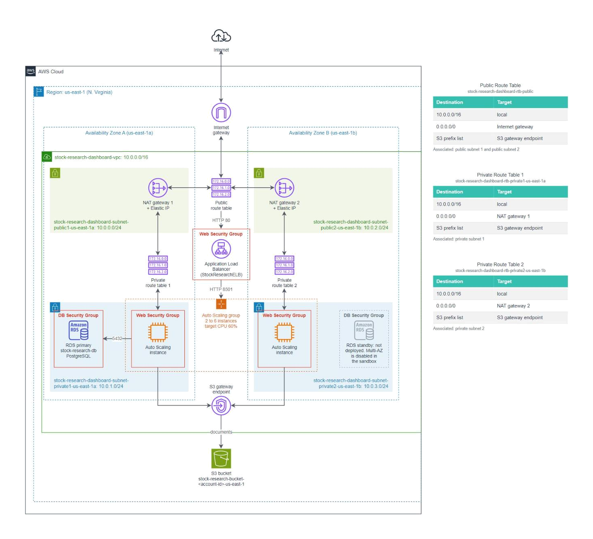
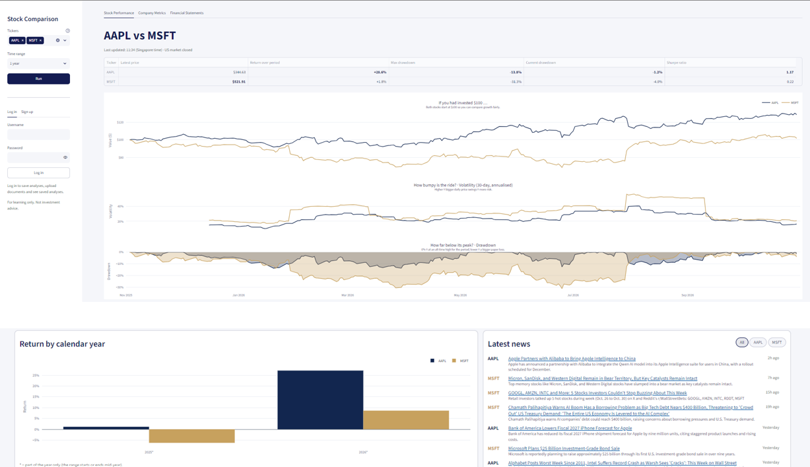
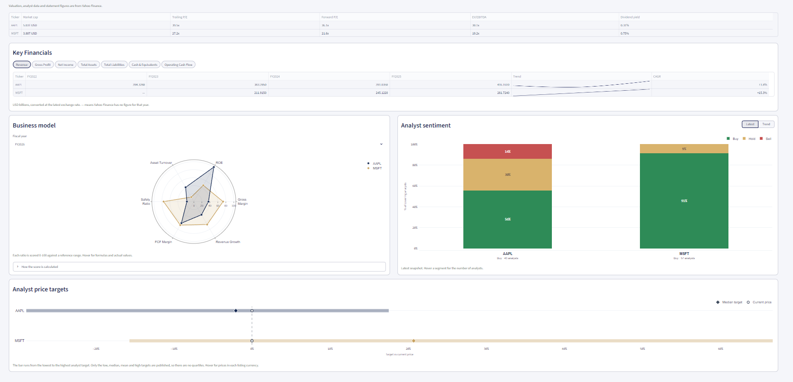
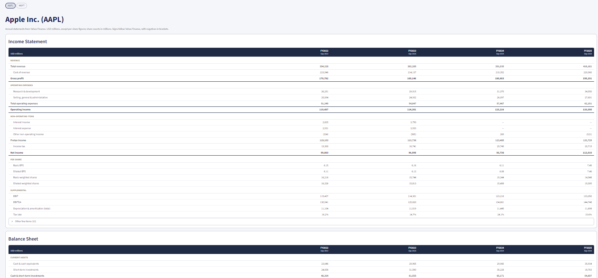

# Cloud Computing Stock Comparison

A Streamlit stock research dashboard, plus the AWS architecture designed to host it.



## Features

### Running an analysis

- Type up to **five tickers** in the sidebar, pressing Enter after each. One ticker shows a single stock; more compare them.
- Pick a time range: **1 year**, **5 years**, **10 years**, **20 years** (default), or **Custom** (any dates within the last 20 years, at least 60 days apart).
- Click **Run**. The results are split across three tabs that share the same tickers.

### Stock Performance tab



- **Metrics:** latest price, return over the period, max drawdown, current drawdown and Sharpe ratio. Shown as cards for one stock, or as a comparison table for several. Hover the help icons for what each one means.
- **Live price:** the **Latest price** refreshes every 60 seconds while the US market is open.
- **Price, volatility and drawdown chart**, from daily closing prices:
  - In comparisons, prices are rebased to $100 at the start of their shared history so growth can be compared fairly. Hovering also shows each stock's actual price.
  - US recessions are shaded, using FRED's USREC series, with known recession dates as a fallback.
- **Return by calendar year** chart. Years only partly inside the range are marked with `*`.
- **Latest news** with short summaries and how long ago each was published, filterable by ticker. Uses the Alpaca News API when keys are set, otherwise Yahoo Finance.

### Company Metrics tab



- **Valuation:** market cap, trailing and forward P/E, EV/EBITDA and dividend yield.
- **Key Financials:** pick a metric (revenue, gross profit, net income, total assets, total liabilities, cash, or operating cash flow) to see every fiscal year the companies share, in USD billions at the latest exchange rate, with a trend sparkline and CAGR.
- **Business-model radar:** five ratios (gross margin, ROE, asset turnover, safety ratio, FCF margin), each scored 0-100.
  - Pick the fiscal year and, for three or more companies, which ones to draw.
  - **How the score is calculated** explains each ratio and lets you edit its low and high reference values.
- **Analyst sentiment:** the latest buy/hold/sell split, or the trend in the share of buy ratings over recent monthly snapshots.
- **Analyst price targets:** low-to-high target ranges compared with the current price.

### Financial Statements tab



- The annual **income statement**, **balance sheet** and **cash flow statement** of one company. When several tickers were run, pick the company at the top.
- Figures are Yahoo Finance's reported values in the company's reporting currency:
  - in millions, except per-share figures (two decimals);
  - negatives in brackets;
  - bold subtotals and double-underlined totals.
- Each statement follows a standard layout (for example revenue, then operating expenses, then net income). All three tables share the same fiscal-year columns, so they line up.
- A row appears only if the company reports it. Every remaining Yahoo row is listed under **Other line items** below each statement.
  - These extra rows mostly break down or restate figures already in the totals (for example, Accounts Receivable and Other Receivables make up Receivables), so do not add them to the totals.

### Accounts and saved documents

- Sign up or log in to **save an analysis** as a Markdown report, **upload** your own Markdown or PDF notes, and browse **Previous Analyses** with search and filters.
- Each document is **private** or **public**, and an `admin` account can manage every document.
- See [Save and View Analyses](#save-and-view-analyses) for details.

## Setup

### Local

1. Create a virtual environment and install the packages.

   ```bash
   python -m venv .venv
   .venv\Scripts\activate
   python -m pip install -r requirements.txt
   ```

2. **Set up `secrets.env`** (optional, for news).

   The news analysis calls the Alpaca News API, which needs API credentials. Get a free key pair from [Alpaca](https://alpaca.markets/), then create a file named `secrets.env` in the project root (next to `src/`) containing:

   ```env
   ALPACA_API_KEY=your-alpaca-api-key
   ALPACA_SECRET_KEY=your-alpaca-secret-key
   ```

   - The file is loaded automatically by `src/data/news.py` via `python-dotenv`.
   - `*.env` is listed in `.gitignore`, so it will not be committed. Never commit or share your keys.
   - Without it, news falls back to Yahoo Finance; stock prices and charts work either way.

3. Run the app from the project root.

   ```bash
   python -m streamlit run src/app.py -- --local
   ```

   - Use `python -m` from the project root: modules import each other as `src.*`, which needs the project root on the import path.
   - `--local` stores accounts and saved documents on this computer (see [Storage](#storage)). Options for the app go after `--`; anything before it is for Streamlit.
   - Without `--local`, the app uses AWS storage (RDS and S3) and reads its settings from SSM Parameter Store. This is how the EC2 web servers run it (see [Running on AWS](#running-on-aws)). On a computer without AWS credentials it only shows an error.

### AWS

The stacks are deployed in `us-east-1` with CloudFormation. The web servers get their code from GitHub and their settings from SSM Parameter Store, so nothing is copied onto them by hand.

1. **Push the code to GitHub.** Each web server clones `github.com/finnlimjc/Cloud-Computing-Stock-Comparison` once, at first boot, and never pulls again.

2. **Create the SecureString parameters** in CloudShell (or **Systems Manager → Parameter Store → Create parameter**):

   ```bash
   aws ssm put-parameter --name /work/stock-research/db-password --type SecureString --value lab-password
   aws ssm put-parameter --name /work/alpaca-api-key --type SecureString --value your-alpaca-api-key
   aws ssm put-parameter --name /work/alpaca-secret-key --type SecureString --value your-alpaca-secret-key
   ```

   - The database password must equal stack 04's `DBMasterPassword` (default `lab-password`).
   - The Alpaca keys are optional. Without them, news falls back to Yahoo Finance.
   - CloudFormation cannot create SecureStrings, which is why these are made by hand. See [documentation/aws-secrets-manager.md](documentation/08-aws-secrets-manager.md).

3. **Create the stacks in order** under **CloudFormation → Create stack → Upload a template file**, keeping the default parameters unless noted:

   | Stack | Template | Notes |
   |---|---|---|
   | 01 | [scripts/01-stock-research-s3-bucket.yaml](scripts/01-stock-research-s3-bucket.yaml) | Private S3 bucket for document files. |
   | 02 | [scripts/02-stock-research-ec2-role-policies.yaml](scripts/02-stock-research-ec2-role-policies.yaml) | Adds the SSM and S3 policies to the existing `EC2InstanceRole`. |
   | 03 | [scripts/03-stock-research-dashboard-vpc.yaml](scripts/03-stock-research-dashboard-vpc.yaml) | VPC, one NAT Gateway per AZ, and the Web Security Group. |
   | 04 | [scripts/04-stock-research-database.yaml](scripts/04-stock-research-database.yaml) | RDS database and the String parameters. Pick stack 03's VPC, the two private subnets (`...-subnet-private1-us-east-1a` and `...-subnet-private2-us-east-1b`) and `Web Security Group`. |
   | 05 | [scripts/05-stock-research-load-balancer.yaml](scripts/05-stock-research-load-balancer.yaml) | Load balancer and Auto Scaling group (2 to 6 instances in the private subnets). Uses the `Work-Role` instance profile. Pick stack 03's VPC, the two public and two private subnets, and `Web Security Group`. |

4. **Open the app.** Allow a few minutes after stack 05 finishes for the instances to install and start, then open `LoadBalancerURL` from stack 05's **Outputs** tab (`http://<load balancer DNS name>`). Until the first instance passes its health check, the load balancer returns `503 Service Temporarily Unavailable`.

5. **Log in as `admin`.** Read its generated password with `aws ssm get-parameter --name /work/stock-research/seed/admin --with-decryption` or look it up in Parameter Store. (see [Demo accounts and the admin](#demo-accounts-and-the-admin)).

## Save and View Analyses

Anyone can run analyses. To save documents, create an account in the sidebar (**Sign up**) or **Log in**. Usernames are 3 to 32 letters, numbers, `-` or `_` (not case-sensitive), and passwords need at least 8 characters. Refreshing the browser logs you out.

After running a single-stock or comparison analysis, choose **Private** or **Public** under **Save as**, then click **Save Analysis** to save a Markdown report. Private documents are visible only to you. Public documents are visible to every logged-in user. Visitors who are not logged in see no saved documents at all. What is saved depends on the open tab:

- **Stock Performance** or **Company Metrics**: price metrics and news, plus valuation, financials, business-model ratios, analyst sentiment with the number of analysts in each bucket, and price targets. Saved as `TICKERS_overview_<time>.md` (or `_single_` for one stock).
- **Financial Statements**: only the company selected in the pills. The report starts with a short explanation of how the figures tally, then each statement's main table followed by its other line items. Saved as `TICKER_statements_<time>.md`.

To add your own notes, open **Upload document**. Pick a Markdown (`.md`) or PDF file of up to 20 MB, and optionally give it a title (defaults to the file name), tickers, and visibility. It is saved as `Title_upload_<time>.md` or `.pdf`.

**Previous Analyses** lists your own documents and everyone's public ones, newest first. To narrow the list, type in **Search**: every word must appear in the title, file name, owner's username or a ticker, ignoring case (for example `aapl overview`). 

Under **Filters** you can also keep only documents covering every selected ticker, of chosen types, or owned by you or by others. The line under the selector shows the tickers, type, time range, creation time, owner, and visibility. Click **Show** to open the document in a pop-up: Markdown is rendered as formatted text, and PDFs open in a viewer. Both have a **Download** button. On your own documents you can also switch between private and public (**Make public** / **Make private**) or **Delete** them.

### Demo accounts and the admin

The first time the app starts, it creates four accounts: `admin`, `alice`, `bob` and `carol`. Each gets a random password, saved where you can read it:

- **Local (`--local`):** appended to `local-data/seed-credentials.txt` (git-ignored, like the rest of `local-data/`).
- **AWS:** saved as an encrypted SecureString in SSM Parameter Store, named `/work/stock-research/seed/<username>`, because the web servers have no SSH access. Open **Systems Manager → Parameter Store → My parameters**, click the name and choose **Show decrypted value**, or run `aws ssm get-parameter --name /work/stock-research/seed/admin --with-decryption` in CloudShell.

On AWS both web servers seed the same database. If both try to create an account at the same moment, the second one skips it.

`admin` is the only admin. An admin:

- sees every document in **Previous Analyses**, including other people's private ones, and can open and download them;
- can **Delete (admin)** any document, private or public, which removes its database row and its file;
- cannot switch other people's documents between private and public. That stays with the owner.

Signing up always creates a normal user, and there is no screen for promoting a user to admin. To change who is an admin, edit `SEED_ACCOUNTS` in `src/storage/seed.py` before the account is first created, or set `is_admin` directly in the `users` table. If you delete `admin` from the table, the next start creates it again with a new password.

### How timestamps are shown

- News providers send publication times in ISO 8601 UTC, such as `2026-10-24T07:28:35Z` (`T` separates the date from the time, `Z` means UTC). Exact times are converted to the time zone of the computer running the app (your computer with `--local`, the EC2 web server on AWS), not the visitor's browser.
- **Dashboard news cards** show a relative age such as `9h ago` or `Yesterday`, counted from the current time, so it is the same in any time zone. Articles older than a week show their date.
- **Saved reports** show exact times with the UTC offset, such as `2026-10-24 15:28:35 UTC+08:00`. This applies to the **Created** line and to each news item. A time that cannot be read is saved unchanged.
- **Saved filenames** use UTC with a trailing `Z`, such as `20261024-072835Z`, so they match the `created_at` value stored in the database whatever the server's time zone.

## Storage

Saved documents are split between a **database** and an **object store**. The database holds small, structured data that the app filters and checks, and the object store holds the file contents. The app always looks up the database row, which decides who may see a document, before it reads the file.

| | Database | Object store |
|---|---|---|
| Holds | Users, document metadata, and access rules | Document contents: Markdown reports and uploaded PDFs, later exported chart PDFs |
| Local (`--local`) | SQLite file `local-data/app.db` | Folder `local-data/objects/` |
| AWS | Amazon RDS for PostgreSQL in the VPC's private subnets | Private Amazon S3 bucket, reached through the VPC's S3 gateway endpoint |

`local-data/` is ignored by Git. Market data (prices, news, statements) is not stored: it is fetched again and cached in memory by `src/dashboard/loaders.py`. API keys stay in `secrets.env` locally, and in SSM Parameter Store on AWS (Secrets Manager in production).

### Database tables

The database has three tables. A user owns many documents, and a document covers many tickers:

```text
users 1 ──── * documents 1 ──── * document_tickers
```

| Table | One row per | Key columns |
|---|---|---|
| `users` | Account | `username` (unique, lower case), `password_hash` (scrypt, see [Password hashing](#password-hashing)), `is_admin` |
| `documents` | Saved or uploaded document | `owner_id`, `object_key` (where the file is, see [Filenames and object keys](#filenames-and-object-keys)), `document_type`, `visibility`, `sha256`, the analysed date range |
| `document_tickers` | Ticker a document covers | `document_id` and `ticker` (together the primary key), `position` (the order the tickers were entered) |

- **Rules in the database:** check constraints allow only `private`/`public` visibility and the four document types (`overview`, `single`, `statements`, `upload`), so a bug in the app cannot save an invalid value.
- **Deletes cascade:** deleting a user deletes their documents, and deleting a document deletes its ticker rows.
- **Indexes match the queries the app runs:** owner + creation time ("my documents"), visibility + creation time ("public documents"), both already newest first, and ticker (the **Tickers** search filter).
- **Portable:** the tables are defined with SQLAlchemy Core in `src/storage/database.py` and use only portable SQL, so the same code runs on SQLite locally and PostgreSQL on RDS. Only the database URL changes.

Every column, type, constraint and index, with examples, is described in [documentation/database-tables.md](documentation/05-database-tables.md).

### Password hashing

Passwords are hashed with [scrypt](https://en.wikipedia.org/wiki/Scrypt), using Python's built-in `hashlib.scrypt`, so there is no extra dependency. The code is in `src/storage/auth.py`.

**Why scrypt**

- If the database leaks, the only way to recover a password from its hash is to guess and re-hash. A fast hash such as SHA-256 lets an attacker try billions of guesses per second on a GPU. scrypt is deliberately slow and needs a large block of memory for every guess, so guessing is expensive and cannot be parallelised cheaply on GPUs or custom chips.
- Each password gets its own random 16-byte salt. Two users with the same password get different hashes, and precomputed tables of common-password hashes are useless.
- Verification compares hashes with `hmac.compare_digest`, which takes the same time whether the first byte or the last byte differs.

**Settings**

| Setting | Value | Meaning |
|---|---|---|
| `N` | 2^14 (16384) | CPU and memory cost. Doubling it doubles both. |
| `r` | 8 | Block size. Together with `N` it sets the memory per hash: 128 × `N` × `r` bytes, about 16 MB. |
| `p` | 1 | Number of independent lanes. 1 means no extra work. |
| Salt | 16 bytes | Random per password. |

These are the commonly used values for interactive logins, and one hash takes roughly 50 to 100 ms. `N`, `r`, `p` and the salt are stored with each hash (`scrypt$n$r$p$salt$hash`), and `verify_password` re-hashes with the values stored in that row. Raising the settings later affects only new passwords. Existing users can still log in, and nothing has to be migrated at once. The hash is not re-hashed with the new settings at login yet.

### Filenames and object keys

Each file's name and location are built only from its database row, so a row points to exactly one file, and any file path leads back to its row:

```text
filename:   {tickers or title}_{document_type}_{created_at in UTC}.{md|pdf}
object key: users/{owner_id}/{document_id}/{filename}

example:    users/3/42/AAPL-vs-MSFT_overview_20261026-060500Z.md
```

- The `document_id` folder keeps keys unique, even when two documents are saved in the same second.
- Visibility is **not** part of the key. Making a document public or private only updates its row, never moves the file, so the S3 bucket can stay fully private with the app as the only gatekeeper.
- The row and the file are saved in one database transaction that commits only after the file is written, so a failed save leaves neither behind. Deleting removes the row and the file together. On S3 the bucket is versioned, so a deleted file can still be recovered for 30 days (see [documentation/aws-s3-bucket.md](documentation/03-aws-s3-bucket.md)).
- Object keys are checked so they cannot point outside the storage folder.

### Running on AWS

The dashboard pages are the same on AWS. Only the storage behind them changes, chosen in `open_store` in `src/app.py`:

- `S3ObjectStore` in `src/storage/object_store.py` has the same `put`, `get` and `delete` methods as `LocalObjectStore`. S3 errors are raised as `OSError`, so the sidebar shows them like local file errors.
- `Database` connects to RDS through `postgres_url` in `src/storage/database.py`: the `psycopg` driver, SSL required, and `pool_pre_ping` so connections RDS has closed are replaced. The app creates the tables on first start.
- `ParameterStore` in `src/storage/parameters.py` reads the settings below with the EC2 instance role, so no keys are stored on the servers. boto3 does not read the Region from the instance by itself, so `use_instance_region` looks it up in the instance metadata first (unless `AWS_DEFAULT_REGION` or `~/.aws/config` already sets one). It also writes the demo account passwords back to Parameter Store.

| Parameter | Type | Created by | Used for |
|---|---|---|---|
| `/work/stock-research/db-password` | SecureString | You, before deploying | RDS master password (must match stack 04's `DBMasterPassword`) |
| `/work/stock-research/bucket-name` | String | Stack 04 | S3 bucket for document files |
| `/work/stock-research/db-host` | String | Stack 04 | RDS endpoint, known only once the database exists |
| `/work/stock-research/db-username` | String | Stack 04 | RDS master username (`main`) |
| `/work/alpaca-api-key`, `/work/alpaca-secret-key` | SecureString | You, before deploying | Alpaca news. Missing keys fall back to Yahoo news. |
| `/work/stock-research/seed/<username>` | SecureString | The app | Passwords of the [demo accounts](#demo-accounts-and-the-admin) |

CloudFormation cannot create SecureString parameters, so only those are created by hand. How to create them is in [documentation/aws-secrets-manager.md](documentation/08-aws-secrets-manager.md). The database port (`5432`) and name (`stockresearch`) are constants in `src/dashboard/config.py`.

**Deployment order:** create the SecureString parameters, then the stacks `01` → `02` → `03` → `04` → `05`. If the instances start before stack 04 has written its parameters, the page shows "Could not open storage: Missing parameters ..." until it has.

## Project structure

```text
.
├── src/
│   ├── app.py                  # Streamlit entry point (run this); --local picks local storage
│   ├── dashboard/              # Streamlit UI
│   │   ├── config.py           # Constants, cache TTLs, storage paths, and page CSS
│   │   ├── loaders.py          # Cached data loaders
│   │   ├── dates.py            # Market hours and date-range resolution
│   │   ├── analysis.py         # Builds the stock analysis result, summary, and saved-report sections
│   │   ├── auth.py             # Log in, sign up, and log out controls
│   │   ├── sidebar.py          # Analysis form, saving, uploads, and saved documents
│   │   ├── performance.py      # Stock Performance tab
│   │   ├── company_metrics.py  # Company Metrics tab
│   │   └── financial_statements.py  # Financial Statements tab
│   ├── plots/                  # Plotly charts
│   │   ├── theme.py            # Shared palette, fonts, and title helpers
│   │   ├── price_plots.py      # Price, volatility, and drawdown dashboard with recessions; calendar-year returns
│   │   └── company_plots.py    # Radar, analyst sentiment, and price-target charts
│   ├── data/                   # Market data loading
│   │   ├── price_ratings.py    # Yahoo Finance prices, statements, ratings, and FX rates
│   │   ├── news.py             # Alpaca and Yahoo Finance news; loads secrets.env
│   │   └── recessions.py       # FRED recession periods with a known-date fallback
│   ├── storage/                # Accounts and saved documents
│   │   ├── auth.py             # Password hashing and username/password rules
│   │   ├── database.py         # Users and document metadata tables (SQLAlchemy Core; SQLite or PostgreSQL)
│   │   ├── object_store.py     # File contents by object key (local folder or S3)
│   │   ├── parameters.py       # Settings and secrets from SSM Parameter Store on AWS
│   │   ├── seed.py             # Creates the demo admin and users on first start
│   │   └── storage.py          # Markdown report builders and the DocumentStore
│   └── analysis/               # Calculations on loaded data
│       ├── transformation.py   # Price metrics, summaries, and relative time
│       ├── fundamentals.py     # Financial statement comparisons and business-model scores
│       ├── statements.py       # Statement layouts and line-item units for the Financial Statements tab
│       └── analyst.py          # Analyst rating periods and buy/hold/sell sentiment
├── .streamlit/config.toml  # Streamlit theme colours and font
├── notebooks/              # Original exploratory notebooks (filings, news, stock_price_ratings)
├── documentation/          # AWS architecture and database write-ups
├── assets/                 # Architecture diagrams
├── scripts/                # CloudFormation templates
├── local-data/             # Local database and saved files (created by --local; git-ignored)
├── secrets.env             # Your API keys (you create this; git-ignored)
└── requirements.txt        # Python dependencies
```

- `src/dashboard/loaders.py` caches price, news, and company lookups for 30 minutes (recession data for a day); ticker and provider problems are shown in the dashboard.
- The notebooks in `notebooks/` are the starting point the functions in `src/` were taken from. Run them with `jupyter notebook` if you want to explore the raw code.

## AWS architecture

The dashboard is designed to run in its own VPC on AWS. These documents describe the design:

- [AWS IAM access architecture](documentation/01-aws-iam-access-architecture.md): IAM Identity Center groups and permission sets. This was designed but not built, because the AWS sandbox does not allow IAM Identity Center or AWS Organizations.
- [AWS Secrets Manager](documentation/08-aws-secrets-manager.md): The keys and the RDS password are stored as SecureString parameters in SSM Parameter Store, created by hand in the console before deploying.
- [AWS S3 bucket](documentation/03-aws-s3-bucket.md): private, versioned bucket for saved Markdown reports and uploaded documents. Built from [scripts/01-stock-research-s3-bucket.yaml](scripts/01-stock-research-s3-bucket.yaml).
- [AWS EC2 IAM role](documentation/07-aws-ec2-iam-role.md): policies on the existing `EC2InstanceRole` that let the web servers read the Alpaca keys and storage settings from SSM, write the demo account passwords there, and manage documents in S3. Built from [scripts/02-stock-research-ec2-role-policies.yaml](scripts/02-stock-research-ec2-role-policies.yaml).
- [AWS VPC architecture](documentation/02-aws-vpc-architecture.md): two-AZ VPC for the Streamlit web servers and S3 uploads. Built from the CloudFormation template [scripts/03-stock-research-dashboard-vpc.yaml](scripts/03-stock-research-dashboard-vpc.yaml).
- [AWS RDS database](documentation/04-aws-rds-database.md): Single-AZ PostgreSQL `db.t3.micro` in the private subnets, reachable only from the Web Security Group, with the rationale for a burstable class. Built from [scripts/04-stock-research-database.yaml](scripts/04-stock-research-database.yaml).
- [AWS Load Balancer and Auto Scaling](documentation/06-aws-load-balancer-auto-scaling.md): internet-facing Application Load Balancer with a sticky target group on port 8501, and an Auto Scaling group of 2 to 6 instances in the private subnets that tracks 60% average CPU. Built from [scripts/05-stock-research-load-balancer.yaml](scripts/05-stock-research-load-balancer.yaml).
