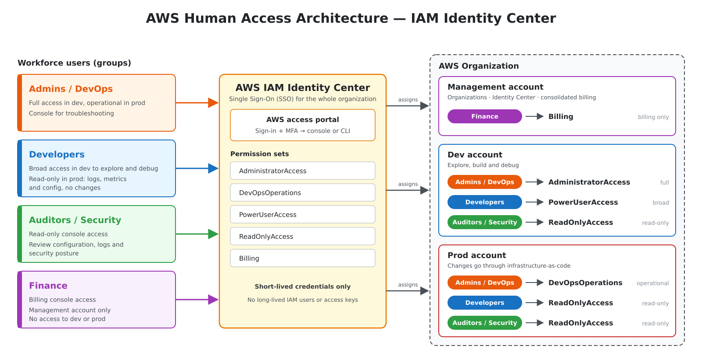

# AWS IAM Architecture

> **Disclaimer:** This setup was designed but not built, because the AWS sandbox used for this project does not allow IAM Identity Center or AWS Organizations to be set up.

## Overview

This diagram shows how people in the organization sign in to AWS and what they are allowed to do in each account. All human access goes through **AWS IAM Identity Center**, which gives every person a single login for both the **AWS Management Console** and the **AWS CLI**. Nobody uses long-lived IAM users or access keys; every session uses short-lived, automatically rotated credentials.

## Components

### 1. Workforce groups

Access is granted to **groups, never to individual users**. A person gets access by being added to the right group.

| Group | Purpose |
|---|---|
| **Admins / DevOps** | Run and support the platform. Full access in dev, operational access in prod. They need the console for troubleshooting. |
| **Developers** | Build and debug applications. Broad access in dev, where exploring the console is useful. Read-only in prod so they can check logs, metrics and configuration without changing anything. |
| **Auditors / Security** | Review configuration, logs and security posture. Read-only console access. |
| **Finance** | Track and manage costs. Billing console access in the management account only. |

### 2. AWS IAM Identity Center

Identity Center is enabled in the management account and acts as the single front door:

- **AWS access portal** – users sign in once with MFA, then pick an account and role to open in the console.
- **Permission sets** – reusable templates of permissions.

| Permission set | Type | What it allows |
|---|---|---|
| `AdministratorAccess` | AWS managed policy | Full access to all services and resources. |
| `DevOpsOperations` | Custom | Operational tasks in prod (e.g. restarting services, scaling, viewing secrets metadata, incident response) without unrestricted admin rights. Define it to match your runbooks. |
| `PowerUserAccess` | AWS managed policy | Full access to services, except managing IAM users, groups and Organizations. |
| `ReadOnlyAccess` | AWS managed policy | View resources, logs, metrics and configuration; no changes. |
| `Billing` | AWS managed job-function policy | View and manage billing, budgets and cost tools. |

### 3. AWS Organization and accounts

Workloads are separated into accounts so that permissions can be different in each environment.

**Management account** – hosts AWS Organizations, IAM Identity Center and consolidated billing. Keep it free of workloads and restrict access to it tightly.

| Group | Permission set | Access level |
|---|---|---|
| Finance | `Billing` | Billing only |

**Dev account** – where teams explore, build and debug.

| Group | Permission set | Access level |
|---|---|---|
| Admins / DevOps | `AdministratorAccess` | Full |
| Developers | `PowerUserAccess` | Broad |
| Auditors / Security | `ReadOnlyAccess` | Read-only |

**Prod account** – where it goes live.

| Group | Permission set | Access level |
|---|---|---|
| Admins / DevOps | `DevOpsOperations` | Operational |
| Developers | `ReadOnlyAccess` | Read-only |
| Auditors / Security | `ReadOnlyAccess` | Read-only |

## Sign-in flow

1. The user opens the AWS access portal and signs in through the identity source, with MFA.
2. The portal shows only the accounts and roles assigned to the user's groups.
3. The user chooses an account and role:
   - **Console:** opens the AWS console as that role.
   - **CLI:** runs `aws sso login --profile <profile>`, which uses the same login and stores temporary credentials locally.
4. The credentials expire automatically at the end of the session duration set on the permission set.

## Design principles

- **Single identity per person** – one login for console and CLI, managed centrally.
- **Least privilege per environment** – the same person has more freedom in dev than in prod.
- **Prod is change-controlled** – only Admins / DevOps can change anything in prod; everyone else is read-only.
- **Separation of duties** – Finance can see costs but cannot reach workloads; Auditors can see everything but change nothing.
- **No long-lived credentials** – no IAM users or static access keys for humans.
- **Group-based assignment** – onboarding and offboarding are done by changing group membership, not by editing policies.