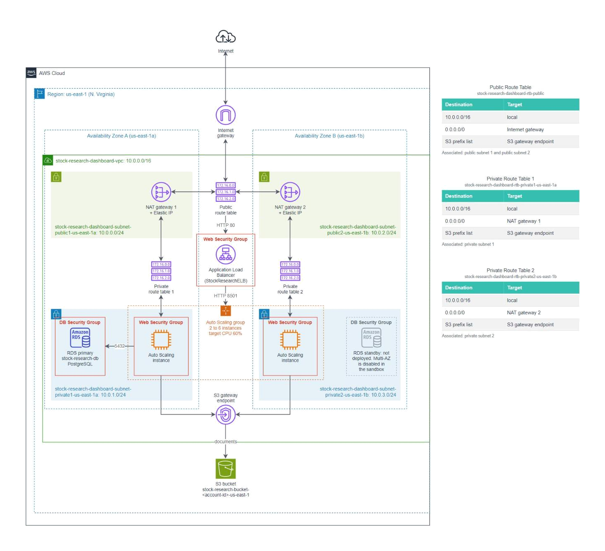

# AWS VPC Architecture

> **Source:** [scripts/03-stock-research-dashboard-vpc.yaml](../scripts/03-stock-research-dashboard-vpc.yaml) (CloudFormation).

> **Disclaimer:** Sandbox settings have restrictions on certain settings, which are all documented in this markdown.

## Overview

The stock research dashboard (a Streamlit app) runs in its own VPC, spread across two Availability Zones for robustness. Users reach the dashboard through a load balancer in the public subnets, which forwards them to the Auto Scaling instances in the private subnets (see [aws-load-balancer-auto-scaling.md](06-aws-load-balancer-auto-scaling.md)). Documents are stored in Amazon S3, and the RDS database sits in the private subnets (see [aws-rds-database.md](04-aws-rds-database.md)).

| Setting | Value |
|---|---|
| Name tag prefix | `stock-research-dashboard` |
| Region | `us-east-1` (sandbox) |
| VPC CIDR | `10.0.0.0/16` (65,536 IPs) |
| Availability Zones | 2 (`us-east-1a`, `us-east-1b`) |
| DNS support / hostnames | Both enabled |

## Region

| Environment | Region | Reason |
|---|---|---|
| Sandbox | `us-east-1` (N. Virginia) | The sandbox only permits this Region. |
| Production | `ap-southeast-1` (Singapore) | Which stocks the company researches is sensitive, and hosting data abroad may raise compliance issues. Keep data in Singapore. |

The template uses `!GetAZs` and `${AWS::Region}`, so moving to Singapore needs no change except the AZ suffix in the Name tags. The AMI ID, which is Region-specific, is in the launch template of stack 05.

## Network layout

| Subnet | Name tag | AZ | CIDR | Route table |
|---|---|---|---|---|
| Public 1 | `stock-research-dashboard-subnet-public1-us-east-1a` | us-east-1a | `10.0.0.0/24` | Public |
| Private 1 | `stock-research-dashboard-subnet-private1-us-east-1a` | us-east-1a | `10.0.1.0/24` | Private 1 |
| Public 2 | `stock-research-dashboard-subnet-public2-us-east-1b` | us-east-1b | `10.0.2.0/24` | Public |
| Private 2 | `stock-research-dashboard-subnet-private2-us-east-1b` | us-east-1b | `10.0.3.0/24` | Private 2 |

A subnet is "public" or "private" because of its route table, not the subnet itself. Public subnets also auto-assign a public IPv4 address to instances on launch.

### Gateways and endpoints

| Resource | Name tag | Purpose |
|---|---|---|
| Internet Gateway | `stock-research-dashboard-igw` | Connects the VPC to the internet. Used by the public route table. |
| NAT Gateway 1 | `stock-research-dashboard-nat-public1-us-east-1a` | Sits in Public 1 with an Elastic IP (`stock-research-dashboard-eip-us-east-1a`). Lets instances in Private 1 open outbound connections without being reachable from the internet. Used by the Private 1 route table. |
| NAT Gateway 2 | `stock-research-dashboard-nat-public2-us-east-1b` | Same for Private 2: sits in Public 2 with its own Elastic IP (`stock-research-dashboard-eip-us-east-1b`). Used by the Private 2 route table. |
| S3 Gateway Endpoint | `stock-research-dashboard-vpce-s3` | Private route to S3 for the PDF notes users upload. Traffic stays on the AWS network and the endpoint itself is free. Attached to all three route tables. |

### Route tables

| Route table | Destination | Target | Associated subnets |
|---|---|---|---|
| `stock-research-dashboard-rtb-public` | `10.0.0.0/16` | local | Public 1, Public 2 |
| | `0.0.0.0/0` | Internet Gateway | |
| | S3 prefix list | S3 Gateway Endpoint | |
| `stock-research-dashboard-rtb-private1-us-east-1a` | `10.0.0.0/16` | local | Private 1 |
| | `0.0.0.0/0` | NAT Gateway 1 | |
| | S3 prefix list | S3 Gateway Endpoint | |
| `stock-research-dashboard-rtb-private2-us-east-1b` | `10.0.0.0/16` | local | Private 2 |
| | `0.0.0.0/0` | NAT Gateway 2 | |
| | S3 prefix list | S3 Gateway Endpoint | |

### NAT Gateways

The Auto Scaling instances behind the load balancer ([scripts/05-stock-research-load-balancer.yaml](../scripts/05-stock-research-load-balancer.yaml)) run in the private subnets. Users reach them through the load balancer, but the instances also open their own connections: `git clone` and `pip` at first boot, then the market-data APIs and SSM Parameter Store. The load balancer only forwards incoming requests, so those outbound connections go through a NAT Gateway instead.

- A NAT Gateway only allows connections started from inside, so the private instances and the RDS database stay unreachable from the internet.
- There is one NAT Gateway per AZ, and each private subnet has its own route table pointing at the NAT Gateway in its AZ. If one AZ fails, the instances in the other AZ keep their outbound access, matching the two-AZ Auto Scaling group. Traffic also stays within its AZ, so there are no cross-AZ data charges. The cost is two sets of hourly and per-GB NAT charges.

## Security

### Web Security Group

| Direction | Protocol | Port | Source | Description |
|---|---|---|---|---|
| Inbound | TCP | 80 | `0.0.0.0/0` (Anywhere-IPv4) | Permit web requests |
| Inbound | TCP | 8501 | `0.0.0.0/0` (Anywhere-IPv4) | Permit Streamlit app |
| Outbound | All | All | `0.0.0.0/0` | AWS default |

- **No SSH (port 22) rule.** Users sign in through the dashboard by opening the public address, and nobody needs shell access to the servers.
- **HTTP is open to Anywhere-IPv4 in the sandbox** because the school's IP ranges are unknown. "My IP" would lock out students whose IP differs from the author's.
- **Production:** restrict ports 80/8501 to the company's IP ranges, and give the load balancer its own security group so the instances accept 8501 only from it.
- Port 8501 is where Streamlit listens. Port 80 is used by the load balancer's listener, which shares this security group (see [aws-load-balancer-auto-scaling.md](06-aws-load-balancer-auto-scaling.md)).

### DB Security Group

Created by [scripts/04-stock-research-database.yaml](../scripts/04-stock-research-database.yaml). It allows only PostgreSQL (TCP 5432) from the Web Security Group, so only the Auto Scaling instances can reach the database. See [aws-rds-database.md](04-aws-rds-database.md#db-security-group).

## Compute

The VPC stack runs no EC2 instances itself. The dashboard runs on the Auto Scaling group's instances in the private subnets, launched from a launch template and reached through the load balancer, both created by [scripts/05-stock-research-load-balancer.yaml](../scripts/05-stock-research-load-balancer.yaml). Instance settings, bootstrap and tags are in [aws-load-balancer-auto-scaling.md](06-aws-load-balancer-auto-scaling.md).

## Sandbox vs production

| Area | Sandbox (now) | Production |
|---|---|---|
| Region | `us-east-1` | `ap-southeast-1` |
| HTTP / Streamlit source | Anywhere-IPv4 | Company IP ranges only |
| Instance entry point | Load balancer | Load balancer, with HTTPS |
